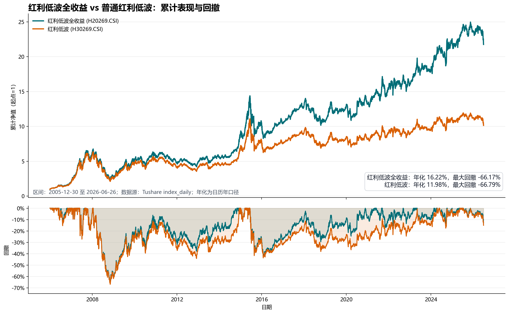

# 红利低波全收益 vs 普通红利低波

- 数据源：Tushare `index_basic` + `index_daily`。
- 指数确认：`H20269.CSI` 为“红利低波全收益”，`H30269.CSI` 为“红利低波”；二者基日均为 2005-12-30，基点均为 1000。
- 最长共同可比区间：2005-12-30 至 2026-06-26，共 4,974 个共同交易日。
- 年化收益口径：`(期末点位 / 期初点位) ^ (365.25 / 自然日跨度) - 1`。
- 最大回撤口径：每日点位相对此前历史高点的最大跌幅。

| 指数 | 代码 | 区间 | 交易日 | 期初点位 | 期末点位 | 总收益 | 年化收益 | 最大回撤 | 最大回撤区间 |
|---|---|---|---:|---:|---:|---:|---:|---:|---|
| 红利低波全收益 | H20269.CSI | 2005-12-30 至 2026-06-26 | 4,974 | 1,000.0000 | 21,758.9590 | 2075.90% | 16.22% | -66.17% | 2008-01-15 至 2008-11-04 |
| 红利低波 | H30269.CSI | 2005-12-30 至 2026-06-26 | 4,974 | 1,000.0000 | 10,152.0928 | 915.21% | 11.98% | -66.79% | 2008-01-15 至 2008-11-04 |

## 结论

在 2005-12-30 至 2026-06-26 的最长共同历史中，全收益指数把分红再投入纳入点位，普通价格指数不纳入分红。因此两者起点相同，但长期差距明显：全收益指数期末累计为起点的 21.76 倍，普通指数为 10.15 倍。

全收益指数年化收益为 16.22%，普通指数年化收益为 11.98%，相差 4.25 个百分点/年。最大回撤方面，全收益指数为 -66.17%，普通指数为 -66.79%；全收益口径的历史最大回撤也更小。

说明：本报告只比较指数点位，不包含 ETF 管理费、跟踪误差、场内折溢价和交易成本，不构成投资建议。
