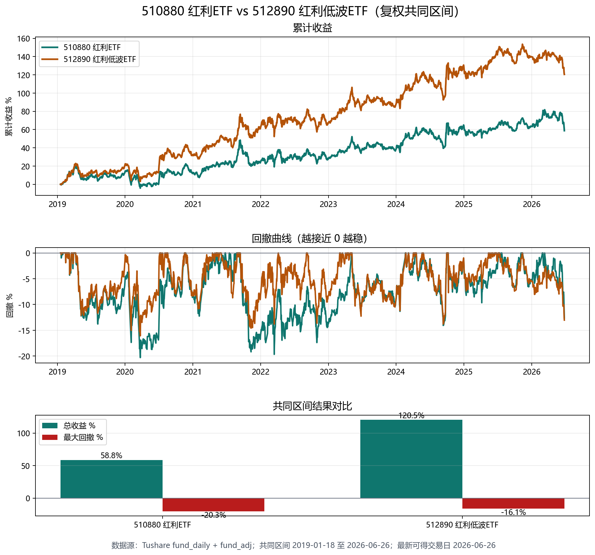

# 510880 红利ETF vs 512890 红利低波ETF

- 数据源：Tushare `fund_daily` + `fund_adj`，使用复权收盘价。
- 共同可比区间：2019-01-18 至 2026-06-26。
- 510880 可复权数据：2018-03-28 至 2026-06-26，2000 行。
- 512890 可复权数据：2019-01-18 至 2026-06-26，1800 行。

| ETF | 总收益 | 年化收益 | 最大回撤 |
|---|---:|---:|---:|
| 510880 红利ETF | 58.79% | 6.42% | -20.29% |
| 512890 红利低波ETF | 120.53% | 11.22% | -16.07% |

说明：该图比较的是 ETF 二级市场复权收盘价表现，不构成投资建议。
