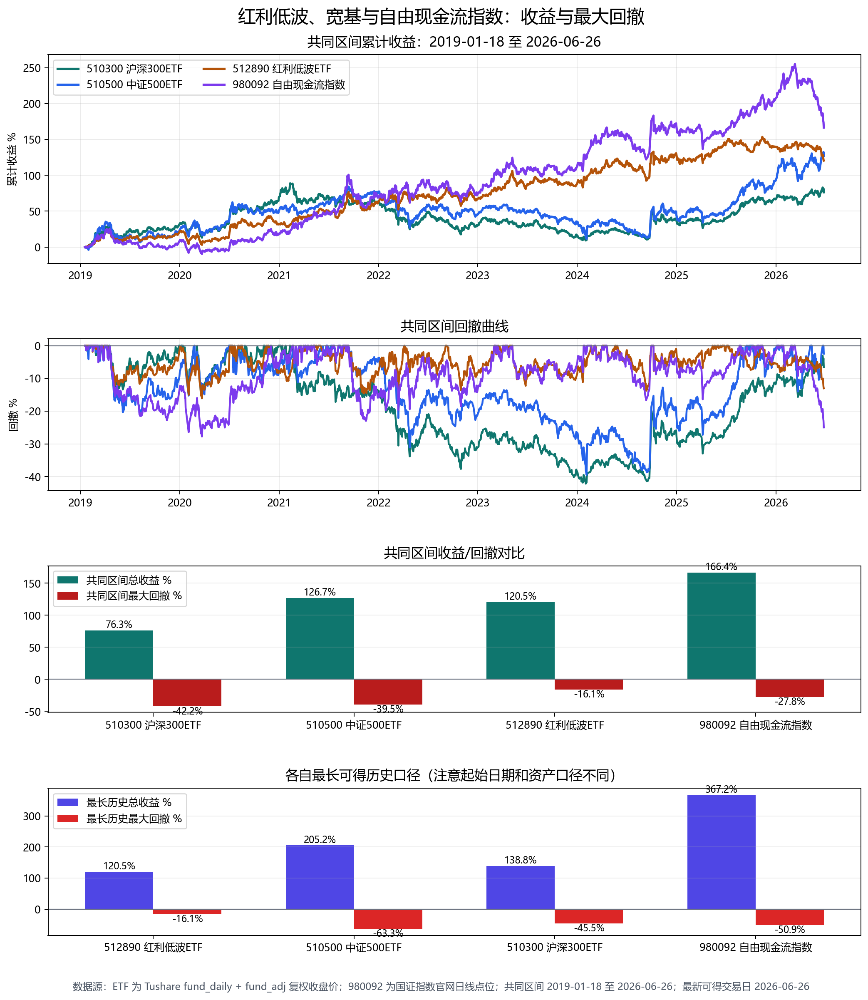

# 红利低波、宽基与自由现金流指数对比

- ETF 数据源：Tushare `fund_daily` + `fund_adj`，使用复权收盘价。
- 自由现金流代理：国证指数官网 `980092` 日线点位。
- 共同可比区间：2019-01-18 至 2026-06-26。
- 最新可得交易日：2026-06-26。
- 注意：980092 是指数点位代理，不是 ETF 交易价格；不含 ETF 管理费、跟踪误差和场内折溢价。

## 共同区间

| 标的 | 总收益 | 年化收益 | 最大回撤 | 年化波动 |
|---|---:|---:|---:|---:|
| 510300 沪深300ETF | 76.34% | 7.93% | -42.16% | 19.20% |
| 510500 中证500ETF | 126.70% | 11.63% | -39.47% | 22.00% |
| 512890 红利低波ETF | 120.53% | 11.22% | -16.07% | 16.94% |
| 980092 自由现金流指数 | 166.44% | 14.09% | -27.76% | 21.14% |

## 各自最长可得历史

| 标的 | 数据源 | 可得区间 | 行数 | 总收益 | 年化收益 | 最大回撤 | 年化波动 |
|---|---|---|---:|---:|---:|---:|---:|
| 512890 红利低波ETF | Tushare fund_daily + fund_adj | 2019-01-18 至 2026-06-26 | 1800 | 120.53% | 11.22% | -16.07% | 16.94% |
| 510500 中证500ETF | Tushare fund_daily + fund_adj | 2013-03-15 至 2026-06-26 | 3224 | 205.20% | 8.76% | -63.27% | 26.13% |
| 510300 沪深300ETF | Tushare fund_daily + fund_adj | 2012-05-28 至 2026-06-26 | 3421 | 138.77% | 6.38% | -45.45% | 22.18% |
| 980092 自由现金流指数 | CNIndex getIndexDailyData index close | 2012-12-31 至 2026-06-26 | 3272 | 367.25% | 12.11% | -50.87% | 22.91% |

说明：共同区间用于公平横向比较；最长历史口径用于观察每个标的自身历史弹性和历史最大回撤，不宜直接比较总收益高低。
该图和表不构成投资建议。
